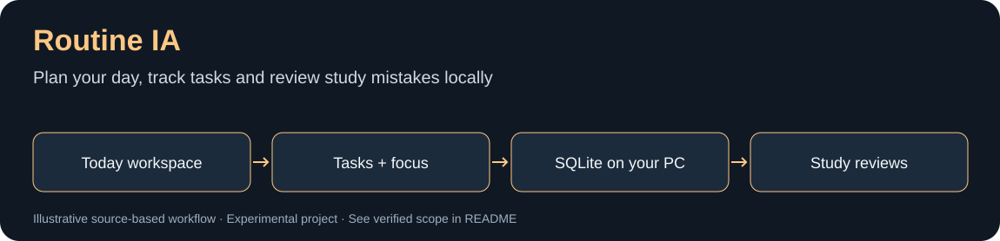

# Routine IA


*Diagrama baseado no código; não representa uma captura da interface nem comprova execução de modelo.*


Aplicativo local para organizar rotina, estudos, foco, projetos e bem-estar. A interface roda em Flask dentro do desktop Windows com pywebview; os dados ficam em SQLite no computador do usuario.

## Instalação inicial / First run

No Windows, com Python 3.11+ instalado, clone o projeto e prepare um ambiente isolado:

```powershell
git clone https://github.com/Michaliszyn01/routine-ia.git
cd routine-ia
py -3 -m venv .venv
```

```powershell
.\.venv\Scripts\python.exe -m pip install -r requirements.txt
```

Para experimentar sem usar o banco pessoal, escolha **uma pasta nova e exclusiva** de demonstração:

```powershell
$env:ROUTINE_IA_DATA_DIR = "$env:TEMP\RoutineIA_first_demo"
$env:ROUTINE_IA_OPEN_BROWSER = "0"
.\.venv\Scripts\python.exe app.py
```

Abra `http://127.0.0.1:5000/` no navegador. Os dados dessa execução ficam na pasta indicada; reutilizar a mesma pasta também reutiliza seus dados. O aplicativo completo pode iniciar serviços locais conforme a configuração; os testes usam `create_app(enable_runtime=False)` e banco isolado. Para o modo desktop, execute `.\.venv\Scripts\python.exe desktop.py` no mesmo ambiente.

Veja [o roteiro e o escopo da demonstração](docs/DEMO.md). Na instalação normal, sem a variável de demonstração, o banco fica em `%LOCALAPPDATA%\RoutineIA\routine.db`.

## Produto

A pagina inicial (`/` e `/today`) e uma central de acao com:

- proxima acao do plano diario;
- tarefas de rotina, estudo, saude, projetos e vida pessoal;
- resumo semanal de estudos e fila de revisao espacada;
- score, sono, energia, foco e carga da semana;
- habitos e atalhos para planejamento, projetos e revisao semanal.

As demais areas continuam disponiveis no catalogo global (`Ctrl+K`): registro diario, planejamento, revisao semanal, foco, estudos, projetos, habitos, objetivos, calendario, saude, alimentacao, evolucao, correlacoes, historico, uso do PC, backup e configuracoes.

## Arquitetura

```text
routine_ia/
|- app.py                    # app factory e APIs historicas compativeis
|- backend/
|  |- db_engine.py           # conexao SQLite, WAL, integridade e diagnostico
|  |- migrations.py          # migracoes numeradas e incrementais
|  |- tasks.py               # tarefas unificadas
|  |- study_reviews.py       # revisao espacada de erros
|  `- workspace.py           # agregacao da central Hoje
|- core/tools/               # motores de dominio (plano, foco, saude, analise)
|- web/
|  |- pages.py               # registro central das paginas
|  |- navigation.py          # navegacao e catalogo de recursos
|  `- workspace_api.py       # APIs da nova central
|- frontend/
|  |- templates/             # telas Jinja
|  `- static/                # CSS, JavaScript, icones e Chart.js local
`- tests/                    # testes de rotas e regras de negocio
```

`create_app(enable_runtime=False)` monta a aplicacao sem iniciar worker, monitoramento, navegador ou backups automaticos. Isso torna testes e scripts de diagnostico previsiveis.

## Banco de dados

O banco persistente fica em:

```text
%LOCALAPPDATA%\RoutineIA\routine.db
```

A conexao central aplica:

- `foreign_keys=ON` para integridade relacional;
- `journal_mode=WAL` e `busy_timeout` para melhor concorrencia local;
- `synchronous=NORMAL` para equilibrio entre seguranca e desempenho;
- migracoes versionadas em `schema_migrations` e `PRAGMA user_version`;
- diagnostico por `GET /api/system/database`, incluindo `quick_check`.

As migracoes sao aditivas. Bancos existentes nao perdem tabelas nem registros.

## APIs novas

```text
GET    /api/workspace
GET    /api/tasks
POST   /api/tasks
GET    /api/tasks/<id>
PATCH  /api/tasks/<id>
POST   /api/tasks/<id>/complete
DELETE /api/tasks/<id>                 # arquivamento logico
GET    /api/studies/reviews
POST   /api/studies/reviews/<error_id>
GET    /api/system/database
```

As APIs anteriores continuam ativas para rotina, saude, foco, projetos, planejamento, revisao, habitos, estudos, monitoramento, relatorios, exportacao, backup e configuracoes.

## Executar

Desenvolvimento:

```powershell
python app.py
```

Desktop:

```powershell
python desktop.py
```

Banco temporario para desenvolvimento:

```powershell
$env:ROUTINE_IA_DATA_DIR="$env:TEMP\RoutineIA_dev"
$env:ROUTINE_IA_OPEN_BROWSER="0"
python app.py
```

## Testes

```powershell
python -m pip install -r requirements-dev.txt
$env:ROUTINE_IA_OPEN_BROWSER="0"
python -m pytest -q
```

A suite cobre a montagem do app, paginas, CRUD principal, plano diario, foco, revisao semanal, saude, monitoramento, analises, tarefas, diagnostico do banco e revisao espacada.

## Executavel Windows

```powershell
.\build_windows.ps1
```

O empacotamento usa `RoutineIA.spec`. Templates, CSS, JavaScript, icones e Chart.js sao incluidos no executavel; dados e backups permanecem fora do bundle, em `%LOCALAPPDATA%\RoutineIA`.

## English overview

A local Windows routine and study planner with Flask, SQLite, optional desktop presentation and spaced reviews. Start with a separate demo data directory, then inspect the Today workspace. The API/testing workflow and desktop runtime have different prerequisites; a passing API check does not establish desktop or monitoring compatibility.
